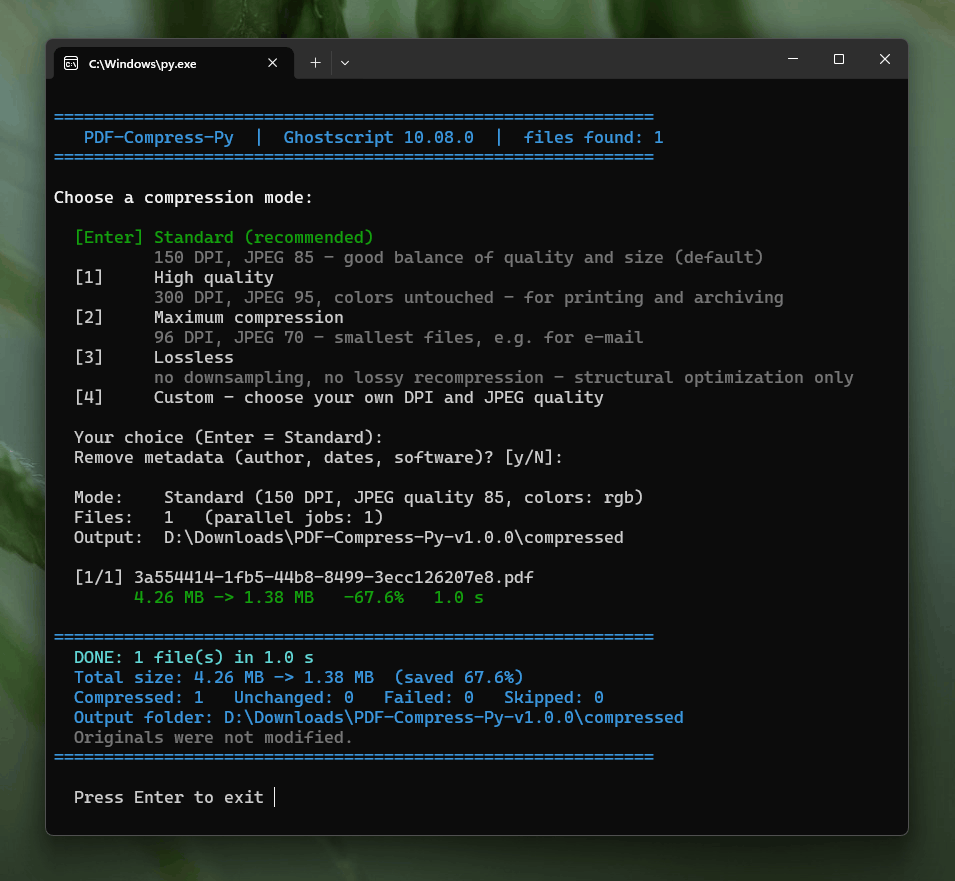

# PDF-Compress-Py

Batch PDF compression for Windows and Linux, powered by [Ghostscript](https://ghostscript.com/).
One Python file, no `pip install`, and it keeps going where simpler wrappers give up.




```text
  [1/5] damaged_report.pdf
        1.30 MB -> 246.6 KB   -81.5%   1.0 s
        note: no startxref token found
        note: xref table was repaired
  [2/5] invoice_scan.pdf
        1.30 MB -> 247.0 KB   -81.5%   0.8 s
  [3/5] locked.pdf
        FAILED: password-protected (a password is required to open it)
```

## Why another PDF compressor?

Most Ghostscript wrappers pass `-dPDFSTOPONERROR`, which aborts on the first structural
hiccup. Real-world PDFs are full of harmless ones (a broken cross-reference table, junk before
the header, a truncated tail), so perfectly readable files get rejected as "corrupted".

`PDF-Compress-Py` is built around the opposite idea:

- **Repairs instead of refusing.** Slightly damaged files are processed, and the problems
  Ghostscript worked around are reported to you. Use `--strict` if you prefer a hard failure.
- **Never trusts an exit code alone.** Ghostscript exits with `0` and writes an empty stub for
  password-protected files. Every result is checked: valid PDF structure, every page written,
  and a sensible size.
- **Retries before giving up.** If a run fails, it is repeated once in a safe mode with the
  fragile optimizations (duplicate-image detection, JPEG pass-through, font subsetting) disabled.
- **Never makes things worse.** If the result is not smaller than the original, the original
  is kept.
- **Any file name works.** Cyrillic, CJK, accents, spaces, `%`, brackets. Files are handed to
  Ghostscript through safe ASCII aliases, so encoding and quoting problems cannot occur.
- **Honest lossless mode.** Photos that are already JPEG are passed through byte-for-byte, and
  everything else stays Flate-compressed (no hidden lossy re-encoding).

## Requirements

- Python **3.8 or newer** (standard library only)
- **Ghostscript** (a recent 10.x is recommended)

| System | Install Ghostscript |
|---|---|
| Windows | `winget install ArtifexSoftware.GhostScript`, or the installer from [ghostscript.com](https://ghostscript.com/releases/gsdnld.html) |
| Debian / Ubuntu | `sudo apt install ghostscript` |
| Fedora / RHEL | `sudo dnf install ghostscript` |
| Arch | `sudo pacman -S ghostscript` |
| macOS | `brew install ghostscript` |

Ghostscript is found automatically: `--gs PATH`, the `PDF_COMPRESS_GS` variable, a
`ghostscript/bin` folder next to the script, `PATH`, and the default Windows install folders
(the Windows installer does not add itself to `PATH`).

## Quick start

```bash
git clone https://github.com/tx2x/PDF-Compress-Py.git
cd PDF-Compress-Py

python pdf_compress.py                    # interactive menu, PDFs in the current folder
python pdf_compress.py scan.pdf           # one file  -> ./compressed/scan.pdf
python pdf_compress.py docs/ -r           # a folder tree, structure preserved
```

On Windows use `py pdf_compress.py ...`. You can also double-click the script: with no arguments
it opens the interactive menu and processes the PDFs in its folder.

Results always go to a separate folder (`./compressed` by default). **Originals are never
modified** unless you pass `--in-place`.

## Presets

| Preset | Images | Best for |
|---|---|---|
| `standard` (default) | 150 DPI, JPEG 85, converted to RGB | everyday use |
| `high` | 300 DPI, JPEG 95, colors untouched | printing, archiving |
| `max` | 96 DPI, JPEG 70, converted to RGB | e-mail attachments |
| `lossless` | no downsampling, no lossy recompression | structure-only optimization |

Vector text and fonts are always kept as they are. The settings only affect raster images
(scans, photos). Override any preset with `--dpi`, `--quality` and `--color`.

## Options

| Option | Description |
|---|---|
| `PATH ...` | PDF files and/or folders |
| `-r`, `--recursive` | search sub-folders of folder inputs |
| `-o`, `--output DIR` | output folder (default `./compressed`); sub-folder layout is mirrored |
| `--suffix TEXT` | append text to output names, e.g. `_small` |
| `--in-place` | replace originals, only when the result is smaller (**no backup**) |
| `--skip-existing` | skip files whose output already exists (resume a batch) |
| `--skip-unchanged` | don't copy files that could not be made smaller |
| `-p`, `--preset NAME` | `standard`, `high`, `max`, `lossless` |
| `--dpi N` | target image resolution (36-1200) |
| `--quality Q` | JPEG quality (10-100) |
| `--color keep\|rgb\|gray` | keep colors, convert to RGB, or to grayscale |
| `--strip-metadata` | remove author, title, dates and XMP metadata |
| `--min-saving PCT` | keep the original unless at least `PCT` % is saved |
| `--strict` | fail on any PDF error instead of repairing it |
| `-j`, `--jobs N` | files processed in parallel (default: up to 4) |
| `--timeout SEC` | give up on a single file after `SEC` seconds |
| `--temp-dir DIR` | where to put temporary files (default: system temp) |
| `--gs PATH` | path to the Ghostscript executable |
| `-n`, `--dry-run` | show what would happen and exit |
| `-v`, `--verbose` | show Ghostscript's output for failed files |
| `--log FILE` | write a detailed log (commands and Ghostscript output) |
| `--no-color` | disable colored output |

## Examples

```bash
# Smallest possible files for e-mail, whole tree
python pdf_compress.py reports/ -r -p max -o small/

# Scanned documents: grayscale, 150 DPI, medium quality
python pdf_compress.py scans/*.pdf --color gray --dpi 150 --quality 70

# Archive copy: no quality loss, strip personal metadata
python pdf_compress.py contract.pdf -p lossless --strip-metadata

# Huge batch: resumable, 2 workers, per-file time limit, full log
python pdf_compress.py archive/ -r -j 2 --skip-existing --timeout 600 --log run.log

# See what would be processed first
python pdf_compress.py archive/ -r -n
```

## How it works

For every file, `PDF-Compress-Py`:

1. Checks the input (readable, non-empty, has a `%PDF-` header).
2. Runs Ghostscript's `pdfwrite` device in a private temporary folder.
3. Judges the outcome: exit code, password prompts, valid PDF structure, and that every
   page was written. On failure it retries once in safe mode.
4. Keeps the result only if it is smaller (and passes `--min-saving`); otherwise the original
   is copied to the output folder, so the output always contains every input file.
5. Moves the output into place atomically, so you never see a half-written file.

`Ctrl+C` stops cleanly: Ghostscript processes are terminated and temporary files removed.

**Exit codes:** `0` success, `1` at least one file failed, `2` usage error / Ghostscript
missing / nothing to do, `130` interrupted.

## Limitations

Compression re-creates the PDF, so keep these in mind for important documents:

- **Digital signatures become invalid.**
- Tagged-PDF structure (accessibility) and PDF/A conformance are not guaranteed to survive.
- Interactive features such as form fields, JavaScript and embedded files may be changed or
  dropped. Always spot-check results you depend on.
- Password-protected files are skipped and reported. Remove the password first.
- Files that Ghostscript could repair are reported with a note. Look at those results.
- Files that contain no raster images (pure text and vector) often can't be made smaller;
  they are kept as they are.

## Troubleshooting

- **"Ghostscript was not found"**: install it (see above) or pass `--gs PATH`.
- **A file fails**: re-run it with `-v --log run.log` and read the Ghostscript output.
  If it works only without `--strict`, the file has structural damage that Ghostscript repairs.
- **A file is "kept as is"**: the compressed version was not smaller, which is normal for
  already-optimized files.
- **Garbled colors in the terminal**: use `--no-color` or set the `NO_COLOR` variable.

## Credits
The code was written using web version of Claude Sonnet 5.5 😁.

## License

MIT, see [LICENSE](LICENSE). Ghostscript itself is a separate program licensed under the
AGPL by Artifex Software. `PDF-Compress-Py` only runs it as an external tool and does not
bundle or modify it.
